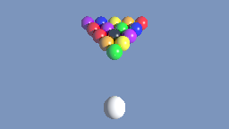

## Initial Pool Ball rendering
For this initial render, we just created multiple instances of a sphere with different colors and set positions 
to resemble a ordinary billard game setup.

## Pool Ball Table Scene, No effects implemented
We combined the pool balls scene with the table in order to create this scene without implementing any 
additional effects other than the ones from A4.

## Pool Ball Table Scene, area light implemented
To implement area lights, we used uniform sampling to pick a sample of 25 points on the area light and 
then calculated the light effect like point lights for each of those sampled points. As a result, the shadows 
created in the new render was more blended and blurred like a real shadow, unlike the old point lights which 
had sharper shadows with spiky edges. However, this increased rendering time as there is much more light points 
to calculate from.

## Added spherical texture rendering for the billard balls and changed the lighting 
To implement the custom pattern on the billard balls, we created a 'texturemaker.py' to create a texture for every
number ball as well as the colors for each ball. We updated the Material class to allow custom textures instead of
just a single color. In order to map the textures onto the balls, we used a spherical mapping function in order to convert 
between coordinates of the sphere and the matching place on the texture. In the function we also added a rotation 
parameter so that we could put random rotation values for each ball so that the scene looks more realistic.

Also changed background color, changed area light values and added ambient light in the scene for the new background
look.

