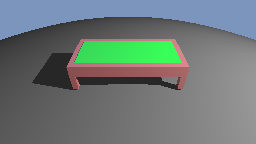
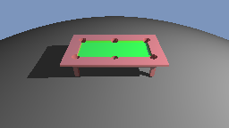
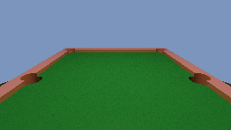

## Initial Table rendering
We used a collection of primitive cubes, scaled and translated to construct this initial build\

## First Table rendering using CSG
The table is constructed by joining boxes to form the main wooden body, as well as the felt.
We then subtracted cylinders to carve out the 6 pockets of the table through the wood and felt.

## Felt Texture Mapping
After constructing the base table with primitve shapes and CSG the next step was texture mapping
the felt to make it look more like a real table. We took a texture image off of the internet and mapped
its pixels onto the pixels of the felt.\
